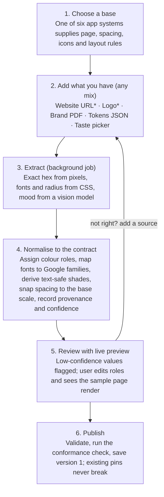

# Custom Design Systems: Collection Funnel Proposal

As of 2026-11-05. Proposal for ledger entry `custom-design-systems` (issue #204). Not yet agreed.

## Summary

Build custom Design Systems as a remix of an App-Owned Design System. Fill it with brand facts taken from the user's website and logo, then confirm it on one review screen with a live preview. Publish it as an ordinary contract-v1 definition owned by the user.

- **Today:** six app-owned YAML systems are seeded into one global Mongo collection. There is no owner, no write API and no logo or font storage. `document-generation-spec.md` puts user-owned systems out of scope.
- **What users have:** almost everyone has a logo and a website. Most can name a few colours. Few know their fonts, and almost none can specify spacing or layout.
- **Top-rated methods (out of 5):** remix an app system 4.50, website URL via a brand API 4.15, in-house URL scrape 4.05, logo colour extraction 4.05. PDF guides, a taste picker, JSON tokens and vision analysis follow in phase 2.
- **Funnel:** choose a base, add sources, extract, normalise to the contract, review with preview, then publish as a versioned system.
- **Main build items:** an owner field, a drafts collection, an intake job, S3 logo storage, a contract v2 `logo` slot, and ownership checks on resolve.

## How Marquill stores Design Systems today

There are six App-Owned Design Systems (Afterglow, Broadside, Colophon, Margin, Overprint, Schematic). Each is a YAML definition that a deploy-time script seeds into one global Mongo collection. There is no owner field, no write API and no storage for logos or fonts. A user-created system therefore needs a new write path, but it can reuse the same contract.

### Where it lives

- Source: `apps/api/assets/design-systems/<id>/definition.ds.yaml`, plus `sample.html` and preview PNGs.
- Database: Mongo `design_systems` (`src/database/schemas/design-system.schema.ts`). Fields: `id`, `version`, `contract`, `name`, `summary`, `definition` (the parsed object), `checksum`, `status` (ACTIVE, SUPERSEDED or RETIRED), `seededAt`. Every field except `status` is immutable. There is a unique index on (`id`, `version`) and one ACTIVE version per slug.
- Only writer: `bun run seed:design-systems`. New systems need an API restart, because the cache never invalidates.
- Preview PNGs are served from the API's local disk, not S3. S3 holds only generated PDFs and Document Source.

### The contract (Zod, contract v1, `src/design-system/design-system-definition.ts`)

| Block | Holds | Constraint that matters for user input |
| --- | --- | --- |
| `page` | Size, safe area, page count, background token | Safe area must be a spacing step |
| `palette` | Tokens `{name, hex, role}`, text/background pairings, min contrast ratio | Roles are only `background`, `text`, `accent`, `border`; external colours are forbidden |
| `typography` | Fonts `{family, source: google or system, weights, fallback}`, a type scale | Families must be on a 12-font Google allowlist; every weight the scale uses must exist |
| `spacing` | Base unit and scale | Every step is a multiple of the base |
| `icons` | Allowed Lucide icons, sizes, colours | Pinned Lucide catalog only |
| `composition` | Page roles, principles, anti-patterns | Free text that feeds the prompt |

A `superRefine` enforces 13 cross-reference rules. Any extracted brand data must be normalised to fit the contract before it can be saved.

### How it is used

1. The web picker (`apps/web/app/redesign/DesignSystemMenu.tsx`) lists summaries from `GET /api/v1/design-systems`. It sends `designSystemId` on create or refine, for documents only.
2. The API pins the active `{id, version}` on the Document Version. Pins resolve forever.
3. `renderPromptFragment` turns the definition into prompt text, and Mark writes HTML/CSS (the Candidate Source). The grammar forbids `url()`, `@font-face` and images.
4. The checker enforces palette, scale, spacing and contrast, with a bounded repair loop. Fonts are inlined from Google, and Browserless renders the PDF.

### Gaps for custom systems

- The spec lists "user- or organisation-owned Design Systems, image assets of any kind" as out of scope. It needs a new section before this work starts.
- There is no `ownerId`. Slugs are globally unique, and list, resolve and pin are global with no ownership checks.
- Logos are impossible today. There is no asset storage, and the grammar and checker forbid images.
- Brand fonts outside the 12-font allowlist are unsupported.
- New systems have no runtime eval gate and no preview generation. App systems pass an offline eval (`UNLISTED_DESIGN_SYSTEMS`).
- There is no tier gating. `Feature` in `tier.schema.ts` has no design-system key.
- In `CONTEXT.md`, the glossary entry for Design System lists "Template" and "theme" under _Avoid_. A "User-Owned Design System" term should be added.

Parts that already exist and can be reused: presigned S3 upload (post media), Browserless sessions, the Zod parser and the checker as a validation layer, and the seed script's checks. There is no vision or image-input LLM code yet.

## What design information users usually have

Almost everyone has a logo, a website or social profile, and a few posts they like. Most can name 3 to 6 colours. Few know their font names, and almost nobody can describe spacing, corner radius or imagery rules. The funnel should therefore extract what it can and ask only about taste.

| Persona | What they have | Format | Reliability |
| --- | --- | --- | --- |
| Solo creator or founder, no guide | A logo (often from Canva or AI), 1 or 2 favourite colours, a LinkedIn banner, a post they liked | PNG/JPG, screenshots, adjectives | Low. Colours exist only in the logo. Needs suggestions, not just extraction |
| Small business | A logo, 1 to 3 hex codes or just "our blue", a Wix/Squarespace/Canva site | PNG/SVG, hex, URL | Medium. Logo and site usually agree. Fonts are often builder defaults |
| Company marketer | A brand guidelines PDF (palette in HEX/CMYK/Pantone, fonts, logo rules, voice), a logo pack, sometimes a brand portal | PDF, zip, portal link | High authority but hard to parse. Often out of date versus the live site. Fonts may be licensed |
| Designer | Figma styles and variables, sometimes a Tokens Studio or DTCG JSON file, font files | Figma, JSON | Highest structure (roles, scales). Tuned for UI, so it needs mapping to documents |
| Team with only a website | A live site, a header logo, favicon, OG image, web fonts | URL | Medium-high for what the site renders. No roles, plus noise from widgets and banners |

Many small users keep their real brand in a Canva Brand Kit. Canva offers no export API for most plans, so a screenshot or manual entry is the fallback. This is from memory and was not verified.

## Rating metrics

Each suggestion is scored from 1 (poor) to 5 (excellent) on six metrics, then weighted to a score out of 5. Accuracy and reach weigh most, because a funnel that most users can't finish, or that produces the wrong brand, fails at its main job.

| Metric | Weight | What a 5 means |
| --- | --- | --- |
| Accuracy | 25% | The output matches the user's real brand (correct hex values, fonts, logo) with little correction |
| Reach | 20% | Most users already have this input, including people with no formal brand guide |
| Low effort | 15% | Takes under 2 minutes and needs no design knowledge |
| Completeness | 15% | Covers colours with roles, type, logo, spacing/shape and imagery/visual style |
| Reusability | 15% | Produces structured, versioned tokens that every renderer can apply the same way |
| Build cost (inverse) | 10% | Can be built mostly from parts Marquill already has |

Weighted score = Σ (score × weight). A score of 4.0 or higher goes in the MVP, 3.0 to 3.9 goes in phase 2, and anything below 3.0 is deferred.

## Collection suggestions, rated

Four of the ten methods score 4.0 or higher. The strongest is **remixing an app-owned system**, because it gives a complete, contract-valid result whatever the user brings. URL extraction and logo colour extraction then fill in the brand.

| # | Method | Acc. | Reach | Effort | Compl. | Reuse | Build | Weighted | Phase |
| --- | --- | --- | --- | --- | --- | --- | --- | --- | --- |
| 1 | Remix an app-owned system (pick Margin, swap colours, font, logo) | 3 | 5 | 5 | 5 | 5 | 5 | **4.50** | MVP |
| 2 | Website URL via a brand API (Brandfetch or Firecrawl `branding`) | 4 | 4 | 5 | 4 | 4 | 4 | **4.15** | MVP |
| 3 | Website URL scraped in-house with Browserless | 4 | 4 | 5 | 4 | 4 | 3 | **4.05** | MVP (or swap for #2) |
| 4 | Logo upload with colour extraction (k-means in OKLCH) | 4 | 5 | 5 | 2 | 4 | 4 | **4.05** | MVP |
| 5 | Brand guidelines PDF parsing (text, hex regex, LLM section finder) | 5 | 2 | 4 | 5 | 4 | 2 | 3.80 | Phase 2 |
| 6 | Taste picker (choose between rendered samples, pick mood words) | 3 | 5 | 4 | 3 | 4 | 4 | 3.80 | Phase 2 |
| 7 | Manual builder from scratch (colour pickers, font picker) | 5 | 3 | 2 | 3 | 5 | 4 | 3.75 | Phase 2, as the review editor |
| 8 | DTCG or Tokens Studio JSON upload | 5 | 1 | 4 | 3 | 5 | 4 | 3.65 | Phase 2 |
| 9 | Screenshots or example posts read by a vision LLM | 3 | 4 | 4 | 4 | 3 | 2 | 3.40 | Phase 2 |
| 10 | Figma API import (variables and styles, OAuth) | 5 | 1 | 3 | 4 | 5 | 1 | 3.35 | Later |

### Why each scored as it did

1. **Remix.** It inherits page, spacing, icons and composition from a system that already passes the eval, so the user changes only what they know. Accuracy is 3 because the layout comes from Marquill, not the brand.
2. **Brand API.** It returns colours with roles, fonts split into title and body, and light/dark logos from a domain alone. Per-call cost and vendor lock-in keep Build at 4, so wrap it behind a provider interface.
3. **In-house scrape.** It reads computed CSS, `:root` variables, font links and header logos through Browserless, which is already deployed. It costs nothing per call but needs filtering for cookie banners and widgets.
4. **Logo colours.** Nearly everyone has a logo, and pixel clustering gives exact hex values. It says nothing about type or layout, so Completeness is 2. It also needs logo asset storage, which doesn't exist yet.
5. **PDF.** It is the most authoritative source, but only company marketers have one. CMYK and Pantone convert to sRGB only approximately, so the user must confirm those values.
6. **Taste picker.** For the persona with no guide, choosing between two rendered pages works better than naming fonts. It sets mood, density and corner style, which no extractor captures.
7. **Manual builder.** It is accurate when the user knows their values, but slow and needs design literacy. Build it once as the review screen and every other method reuses it.
8. **DTCG JSON.** The W3C format is stable as of 2025.10, so import is cheap and exact, but few users have a file.
9. **Vision LLM.** Good at style and mood, unreliable at exact hex values. Use it only for qualitative fields and role naming, and take hex from pixels. Marquill has no image-input LLM code yet.
10. **Figma API.** Variables need an Enterprise plan, and OAuth adds work. A JSON upload (#8) covers designers for far less.

### Required in every path

These are not rated, because none of them is optional.

- **Font resolution.** Map any detected family to the allowlist or the nearest Google font, and say what was substituted.
- **Contrast check with auto-fix.** Keep the brand colour for fills, and derive a text-safe shade when it fails.
- **Live preview.** Render the system's sample page through Browserless before saving.

## Recommended funnel

The funnel has six stages. It never starts from a blank page, and it never saves anything the user hasn't seen rendered.

\* MVP sources. The others follow in phase 2.

Stage 2 accepts any mix of sources. When sources disagree, the most authoritative one wins, in this order: Tokens JSON, PDF, URL, logo, vision. Because stage 1 fills every slot, a user with only a logo still ends up with a complete, valid system.

| Persona | Sources added | Expected time |
| --- | --- | --- |
| Solo creator, no guide | Logo, taste picker | About 1 minute |
| Small business | URL, logo | About 1 minute |
| Company marketer | PDF, URL | 2 to 3 minutes, mostly confirming |
| Designer | Tokens JSON | About 1 minute |
| Website-only team | URL | Under 1 minute |

These times are estimates to test in usability sessions, not measurements.

## Data model and API changes

Keep contract v1 as the only thing generation reads. Intake happens in a separate draft that holds sources, candidates and confidence. The draft compiles to a v1 definition when the user publishes. Only logos need a contract change (v2).

### Storage

| Change | Where | Detail |
| --- | --- | --- |
| Owner on `design_systems` | `design-system.schema.ts` | Add `ownership: APP or USER` and `ownerId` (a user now, a workspace later). Use generated slugs for user systems (for example `u-7f3k2a`) so the global unique index still holds |
| New `design_system_drafts` collection | new schema | `ownerId`, `baseSystemId`, `sources[]` (url, logo, pdf, json, taste), `candidates` (colours, fonts, radius, mood) each with `provenance` (extracted, user, derived) and `confidence`, a `tokens` object in DTCG format, the compiled `definition`, `previewKeys[]`, `status` |
| Brand assets in S3 | `design-systems/<ownerId>/<id>/<version>/logo-{light,dark}.svg` or `.png` | Reuse the presigned upload in `s3.client.ts`. Sanitise SVG (no scripts or external refs), and require raster logos at least 500 px wide |
| Preview PNGs in S3 | `design-systems/<ownerId>/<id>/<version>/previews/page-NN.png` | Rendered from the base system's `sample.html` with the new tokens |
| Contract v2: `logo` block | `design-system-definition.ts` | `{ light, dark, minWidthPx, placement }`. Mark writes an empty slot (`
`) and `assemble.ts` injects the image, so the no-`url()` rule for generated CSS still holds |

### Endpoints

Document these in `docs/api/design-systems.md`, and update `apps/web/app/redesign/designSystems.ts` in the same change.

| Method | Path | Purpose |
| --- | --- | --- |
| POST | `/api/v1/design-systems/drafts` | Start a draft from a base system |
| POST | `/api/v1/design-systems/drafts/:id/sources` | Add a URL, logo, PDF, JSON file or taste answers. Queues a BullMQ `design-system-intake` job |
| GET | `/api/v1/design-systems/drafts/:id` | Return candidates with confidence, contrast results and preview status |
| PATCH | `/api/v1/design-systems/drafts/:id` | Save the user's edits from the review screen |
| POST | `/api/v1/design-systems/drafts/:id/publish` | Compile, validate with `parseDesignSystemDefinition`, run the conformance check, and create version 1 or a new version |
| GET | `/api/v1/design-systems` | Also return the caller's own systems, marked `ownership: USER` |
| DELETE | `/api/v1/design-systems/:id` | Set the system to RETIRED. Existing pins still resolve |

### Other changes

- `getActive`, `resolve` and `pinForRefine` check `ownerId` against the Clerk user. Keep caching app systems as today, and read user systems fresh or with per-id invalidation.
- Font allowlist: let user systems use any Google family the inliner can fetch, checked at publish for the weights the scale needs. Keep the 12-font list for app systems.
- Tiers: add a `custom_design_systems` key to `Feature` with a per-tier count, and keep `src/scripts/tier-seeds.ts` and `apps/landing/components/landing/data.tsx` in sync.
- Docs: add a section to `document-generation-spec.md` that lifts the out-of-scope line, and add "User-Owned Design System" to `apps/api/CONTEXT.md`.
- Ledger: move `custom-design-systems` to `building` when work starts.

## Risks, open questions, next steps

The biggest risk is a confident wrong guess. Showing confidence and a live preview on the review screen does more for accuracy than any single extraction method.

### Risks

| Risk | Mitigation |
| --- | --- |
| Extraction picks the wrong colours (cookie banners, widgets, a stale site) | Weight colours by visible area, flag low confidence, and have the user confirm roles on review |
| A brand colour fails contrast as text | Keep it for fills, derive a text-safe shade in OKLCH, and tell the user |
| Licensed or custom brand fonts | Never scrape or embed them. Map to the nearest Google font and say so. Font upload with a licence confirmation comes later |
| User systems produce worse documents than app systems, which pass an offline eval | Run a conformance check on the sample page at publish, and track repair-loop failure rates per system |
| Logo injection weakens the "no external resources" render guarantee | Only `assemble.ts` inserts the logo, as an inlined data URL from Marquill's own bucket |
| A third-party brand API costs too much or goes down | Use a provider interface, with the in-house Browserless scrape as the fallback |

### Open questions

- Are custom systems per user or per workspace at launch?
- Which tiers get them, and how many per tier?
- For URL extraction in the MVP, buy (Brandfetch or Firecrawl) or build (Browserless)?
- Should brand voice (tone from a PDF or website) feed `stylePreset`, or stay out of scope?

### Next steps

- [ ] Agree the open questions above.
- [ ] Add the spec section to `document-generation-spec.md` (lifting the out-of-scope line, contract v2 `logo` block).
- [ ] Add "User-Owned Design System" to `apps/api/CONTEXT.md`.
- [ ] Build the MVP: drafts, remix, URL, logo, review screen, publish.

## Sources

- Repository: `apps/api/src/design-system/`, `apps/api/docs/document-generation-spec.md`, `apps/api/docs/api/design-systems.md`, `packages/product/src/features.ts`
- [W3C Design Tokens format 2025.10](https://www.w3.org/community/reports/design-tokens/CG-FINAL-format-20251028/)
- [Brandfetch Brand API](https://brandfetch.com/developers/brand-api.md)
- [Firecrawl branding format v2](https://firecrawl.dev/blog/branding-format-v2)
- [Google Pomelli launch coverage](https://www.searchenginejournal.com/google-labs-deepmind-launch-pomelli-ai-marketing-tool/559569/)
- Competitor details for Canva, Adobe Express, Gamma, Looka and Figma come from memory and were not checked against current docs.
